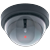
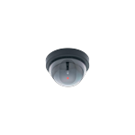
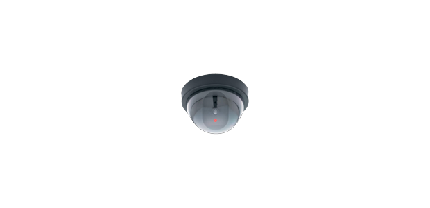

# Universal Motion Detector Elite

UWP webcam motion detector for Windows 10/11 (and devices like Windows on Raspberry Pi with a camera). Video is processed **on-device**; optional email, webhooks, Discord, and IFTTT only send data when you enable them.

**Version:** 5.1.3  
**Package:** `24191RTApplications.UniversalMotionDetectorElite`  
**Publisher:** RT Apps

<p align="center">
  
  &nbsp;
  
  &nbsp;
  
</p>

---

## Screenshots

### Branding / tiles

| Store | Medium tile | Wide tile | Splash |
|:-----:|:-----------:|:---------:|:------:|
|  |  |  |  |

### App UI (reference)

Dashboard, settings, and capture flow (legacy capture shots — UI has been refreshed since these were taken):


> **Current UI highlights:** live stats bar (camera, FPS, last motion, alerts today), baseline/alerts side panel, leave-the-room countdown, dual-camera layout (premium), redesigned settings, in-app documentation, alert history, and optional partner promo banner (hidden with Remove Ads / Premium).

---

## Features

### Free tier

- **On-device motion detection** with adjustable pixel and image delta sensitivity
- **Day / night image delta** and dark-shift threshold for low light
- **Camera selection** and capture/alert timing controls
- **Leave-the-room countdown** before arming (baseline capture after countdown)
- **Ignore zones** — mask top/bottom/left/right % (windows, clocks, etc.)
- **Email alerts** with multi-recipient support and SMTP test  
  - Presets: Gmail, Outlook, Yahoo, iCloud, Custom (use **app passwords**, not normal logins)
- **Generic webhooks** on alert
- **Local event logging**
- **Config export / import**
- **Sound preview** and **dark theme**
- **Dashboard stats** — live FPS, last motion time, alerts today
- **Save alert images** from the Alerts list (context menu)
- **In-app documentation** with setup guides

### Premium (`Unlock Premium Features` — Microsoft Store)

| Feature | Description |
|--------|-------------|
| **Hidden mode** | Browser-style cover UI while monitoring continues |
| **Alert sounds** | Continuous / custom alert audio |
| **Alert history** | Searchable local history + CSV export |
| **Active hours schedule** | Arm only during chosen days/times |
| **Named zones & smart filter** | Zone name + minimum motion area % |
| **Alert clips & buffer** | Rolling frame buffer; short image clips on alert |
| **Discord / IFTTT** | Webhooks and IFTTT applets |
| **Multi-camera** | Secondary camera preview on the dashboard |
| **Night vision preset** | Low-light sensitivity profile |
| **Quiet sound hours** | Suppress alert audio in a window |
| **Settings PIN** | Optional PIN / lock when armed |
| **Health check** | Periodic health settings for long runs |
| **Night recipient rules** | Alternate email recipient overnight |
| **Ad removal** | Included with premium (or separate **Remove Ads** IAP) |

In-app purchases are handled by the **Microsoft Store**. Free tier shows premium items in the nav (locked) until unlocked.

---

## Getting started

1. Open **Settings** and select your camera (settings auto-save).
2. Optionally configure **email** (provider + app password) and run **Test SMTP Connection**.
3. Set **Alert Countdown** under motion detection.
4. On **Dashboard**, press **Start Countdown**, leave the room, and wait for baselines.
5. After the timer and enough baseline frames, alerting goes live.

**Tips**

- Prefer a stable scene (avoid fans, TVs, swaying plants).
- Raise image / night delta if you get night false positives.
- Use edge ignore zones for outdoor windows.
- Export config before reinstalling.

---

## Privacy

- Camera frames are processed **locally** for motion detection.
- Images and logs stay in app local storage unless you enable email, webhooks, Discord, or IFTTT.
- No account is required for free features.
- Store purchases go through Microsoft.

---

## Project layout

```
MotionDetector/
├── MotionDetector/                 # UWP app project
│   ├── Assets/                     # Tiles, splash, sounds, promo art
│   ├── Models/                     # Config, SMTP, alert history, etc.
│   ├── Utilities/                  # Camera, motion, SMTP, store, schedule…
│   ├── ViewModels/
│   └── Views/                      # Dashboard, Settings, Hidden mode, Docs…
├── .gitignore
└── README.md
```

---

## Build

- **IDE:** Visual Studio 2019/2022 with **Universal Windows Platform** workload  
- **Target:** Windows 10 `10.0.19041.0`+ (see `Package.appxmanifest`)  
- Open the solution under `MotionDetector/`, restore packages, deploy to **Local Machine** or a remote Windows device with webcam capability.

Signing: local/dev uses a temporary key (`.pfx` files are gitignored). Store association and packaging artifacts are not committed.

---

## What’s new (recent changes)

### Product / UX

- Redesigned **Dashboard** — stats bar, baseline/alerts panel, fixed stop-sound control, countdown overlay
- **Secondary camera** layout on dashboard (premium)
- Improved **Hidden mode** browser chrome (back/forward/refresh, status, exit)
- Expanded **Settings** (day/night deltas, ignore zones, webhooks, SMTP providers, auto-save)
- New pages: **Alert History**, **Premium Features**, **Documentation**
- **Schedule**, **Discord/IFTTT**, **alert clips/buffer**, **health check**, **PIN**, quiet hours, night recipient
- Partner **promo banner** with rotation; hide via Remove Ads / Premium
- Updated app **tiles, splash, and store logos**

### Reliability / platform

- Camera selection and capture lifecycle fixes
- Motion/config service updates and config versioning
- SMTP multi-provider helpers and connection test
- Store/IAP helpers for premium and remove-ads
- Local alert history + CSV export utilities
- Rating nag / promo ad services
- `.gitignore` hardened (`.vs/`, `*.user`, store association, certs, logs) so secrets and IDE junk stay out of git

---

## License / contributing

See repository license (if present) and open issues/PRs against this repo. Do not commit `.pfx`, `Package.StoreAssociation.xml`, `.user` files, or real SMTP/webhook credentials.
